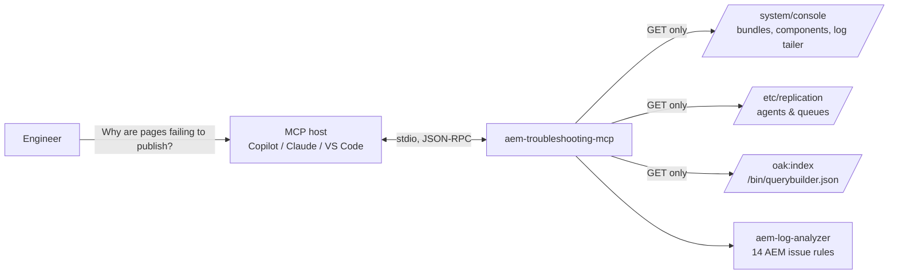

# aem-troubleshooting-mcp-server

[](https://github.com/navi00498/aem-troubleshooting-mcp-server/actions/workflows/ci.yml)


A **read-only [Model Context Protocol](https://modelcontextprotocol.io) server for Adobe Experience Manager (AEM)**.
It lets an AI assistant (GitHub Copilot, Claude, VS Code agent mode) triage an AEM 6.5 / AMS instance the way a
support engineer would: check OSGi bundles and components, replication queues, Oak indexes and logs, then explain
what is wrong and what to do next.

> "Why is publishing slow on author?" → the assistant calls `aem_health_summary`, sees the `publish` queue is blocked
> by an item retried 14 times, finds the matching `ReplicationException` in `error.log`, and tells you which item to
> clear instead of clearing the whole queue.

## Why

During an AEM incident the first 30 minutes are always the same: open the Felix console, scan bundles, open the
replication agents, tail `error.log`, grep for `OutOfMemoryError` and traversal warnings, check index definitions.
This server packages that runbook as **safe, structured tools** an assistant can call, so triage is fast,
consistent and explainable.



## Tools

| Tool | What it does | AEM endpoint |
|---|---|---|
| `aem_health_summary` | One-call triage: bundles, components, replication, error.log findings → `healthy` / `degraded` / `critical` | all below |
| `aem_connection_info` | Shows the target URL/auth mode (never the password) and checks reachability | `/system/console/bundles.json` |
| `list_bundles` | Bundles that are not Active (or all, filtered), with hints for *Installed* vs *Resolved* | `/system/console/bundles.json` |
| `list_component_problems` | DS components that are unsatisfied or failed activation | `/system/console/components.json` |
| `check_replication_queues` | Every agent's queue: `blocked` / `paused` / `backlog` / `ok`, head-of-queue item and retry count | `/etc/replication/agents.author/*/jcr:content.queue.json` |
| `tail_log` | Last N lines of any log, with regex/text grep | `/system/console/slinglog/tailer.txt` |
| `analyze_error_log` | OOMs, traversal queries, unclosed resolvers, service-user mapping, top errors | log tailer + [aem-log-analyzer](https://github.com/navi00498/aem-log-analyzer) |
| `analyze_request_log` | p50/p90/p99 latency, slowest URLs, 4xx/5xx breakdown | log tailer + aem-log-analyzer |
| `list_oak_indexes` | Index inventory with warnings (`reindex=true`, Lucene without `async`, disabled) | `/oak:index.1.json` |
| `get_index_definition` | Full definition of one index (falls back to depth 5 for huge indexes) | `/oak:index/<name>.infinity.json` |
| `query_content` | Scoped QueryBuilder search for evidence ("which pages use template X?") | `/bin/querybuilder.json` |

Plus a prompt, **`triage_aem_incident`**, that walks the assistant through a structured incident runbook.

## Safety model

This server is designed to be pointed at real environments without fear:

- **Read-only by construction.** The HTTP client only issues `GET` requests and every tool is annotated
  `readOnlyHint: true`. There are no tools to clear queues, restart bundles or modify content.
- **No secrets in output.** Replication agent `transportUser`/`transportPassword` are never returned and credentials
  are stripped from transport URIs. `aem_connection_info` reports the auth *mode*, not the password.
- **Query guardrails.** QueryBuilder searches must be scoped below `/content`, `/conf`, `/apps`, `/libs`, `/etc` or
  `/var` (at least two levels deep), `p.limit` is capped at 100 and `p.guessTotal` is always on, so an assistant
  can't trigger a repository-wide traversal.
- **Bounded responses.** Log reads, index definitions and HTTP bodies are size-capped to protect both AEM and the
  model's context window.
- **Clear errors.** 401/403/404, login-page redirects, timeouts and unreachable hosts become actionable messages.

Use a dedicated read-only user where possible.

## Quick start

Requires Python 3.10+. With [uv](https://docs.astral.sh/uv/):

```bash
uvx --from git+https://github.com/navi00498/aem-troubleshooting-mcp-server aem-troubleshooting-mcp --version
```

or with pip:

```bash
pip install git+https://github.com/navi00498/aem-troubleshooting-mcp-server
```

Configuration is via environment variables:

| Variable | Default | Notes |
|---|---|---|
| `AEM_URL` | `http://localhost:4502` | Author or publish base URL |
| `AEM_USER` / `AEM_PASSWORD` | – | Basic auth |
| `AEM_TOKEN` | – | Bearer token (takes precedence over basic auth) |
| `AEM_TIMEOUT` | `20` | Seconds per request |
| `AEM_VERIFY_TLS` | `true` | Set `false` only for local self-signed certs |

### Try it without AEM

The repo ships a mock AEM author instance with realistic problems planted in it (a blocked replication queue, a
bundle stuck in *Installed*, a failed component, an index with `reindex=true`, an `OutOfMemoryError` in the logs):

```bash
git clone https://github.com/navi00498/aem-troubleshooting-mcp-server && cd aem-troubleshooting-mcp-server
pip install -e .
python examples/demo_client.py
```

```text
Connected. 11 read-only tools: aem_connection_info, aem_health_summary, list_bundles, ...

Overall: CRITICAL
  - 2 bundle(s) not active
  - 2 component(s) unsatisfied or failed
  - replication queue 'publish' is blocked (37)
  - error.log: [critical] JVM OutOfMemoryError
  - error.log: [high] Uncaught exceptions while rendering requests (HTTP 500)
  - error.log: [high] Oak queries traversing the repository (missing index)
  - error.log: [high] Replication / content distribution failures
  - error.log: [high] Oak query aborted after hitting the read/traversal limit

Replication 'publish': The first item has been retried 14 times and is blocking the queue. Check the agent log and
the target instance (credentials, disk space, receiving servlet). If the item itself is bad, clear only that item
rather than the whole queue.

Guardrail check (query on '/'): Error executing tool query_content: Path '/' is too broad. ...
```

To point a real MCP host at the mock, run `aem-mock-server --port 4502` in another terminal.

## Connect it to your assistant

**VS Code (Copilot agent mode)** – `.vscode/mcp.json`:

```json
{
  "inputs": [{ "type": "promptString", "id": "aem-password", "description": "AEM password", "password": true }],
  "servers": {
    "aem": {
      "type": "stdio",
      "command": "uvx",
      "args": ["--from", "git+https://github.com/navi00498/aem-troubleshooting-mcp-server", "aem-troubleshooting-mcp"],
      "env": { "AEM_URL": "http://localhost:4502", "AEM_USER": "admin", "AEM_PASSWORD": "${input:aem-password}" }
    }
  }
}
```

**GitHub Copilot CLI** – `~/.copilot/mcp-config.json`:

```json
{
  "mcpServers": {
    "aem": {
      "type": "local",
      "command": "uvx",
      "args": ["--from", "git+https://github.com/navi00498/aem-troubleshooting-mcp-server", "aem-troubleshooting-mcp"],
      "env": { "AEM_URL": "http://localhost:4502", "AEM_USER": "admin", "AEM_PASSWORD": "admin" },
      "tools": ["*"]
    }
  }
}
```

**Claude Desktop** – `claude_desktop_config.json`:

```json
{
  "mcpServers": {
    "aem": {
      "command": "uvx",
      "args": ["--from", "git+https://github.com/navi00498/aem-troubleshooting-mcp-server", "aem-troubleshooting-mcp"],
      "env": { "AEM_URL": "http://localhost:4502", "AEM_USER": "admin", "AEM_PASSWORD": "admin" }
    }
  }
}
```

Then ask things like:

- *"Run a health check on my local AEM author and tell me what to fix first."*
- *"Is anything stuck in replication? What's at the head of the queue?"*
- *"error.log is full of traversal warnings – which queries, and which index would fix them?"*
- *"Show me the definition of cqPageLucene and whether it would cover a query on cq:template."*

## Compatibility

| Target | Status |
|---|---|
| AEM 6.5 on-prem / Adobe Managed Services | ✅ All tools |
| Local AEM SDK (AEMaaCS quickstart) | ✅ All tools except replication (uses Sling Content Distribution) |
| AEM as a Cloud Service environments | ⚠️ `/system/console` and log tailer aren't exposed; use Cloud Manager logs. Index and query tools work with a suitable token. |

The request log appender is assumed to be `/logs/request.log`; pass `log_name` if yours differs.

## Development

```bash
uv venv && uv pip install -e . ruff
python -m unittest discover -s tests -v   # 34 tests: pure analysis, HTTP client vs mock, MCP protocol in-memory
ruff check . && ruff format --check .
```

CI runs lint, the test suite on Python 3.10–3.13 and an end-to-end stdio smoke test against the mock.

Project layout:

```text
src/aem_mcp/
  server.py     # MCP tools + prompt (MCP Python SDK)
  client.py     # GET-only HTTP client, auth, error mapping
  analysis.py   # pure functions: summaries, warnings, guardrails (unit-tested)
  mock_aem.py   # fake AEM author used by tests, demo and CI
```

## Roadmap

- Cloud Manager log download API for AEMaaCS
- Sling Content Distribution queue status
- Thread dump capture and analysis (blocked threads, long-running requests)
- Dispatcher cache/flush checks
- Package Manager and Sling job queue inspection

## Disclaimer

Personal project, not affiliated with or endorsed by Adobe. Built from public AEM, Apache Sling, Apache Felix and
Apache Jackrabbit Oak documentation. The mock server and sample logs are entirely synthetic.

## License

[MIT](LICENSE)
